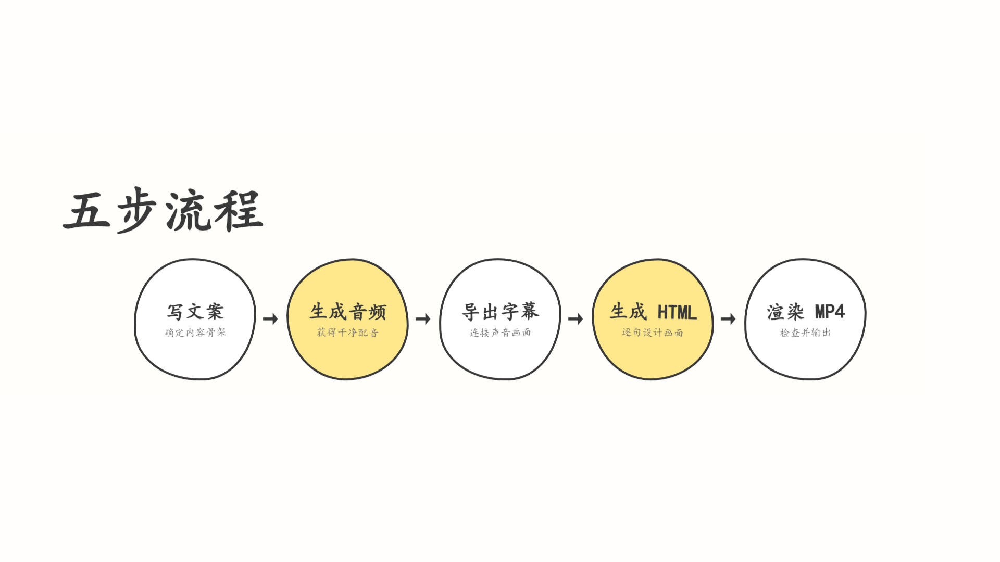
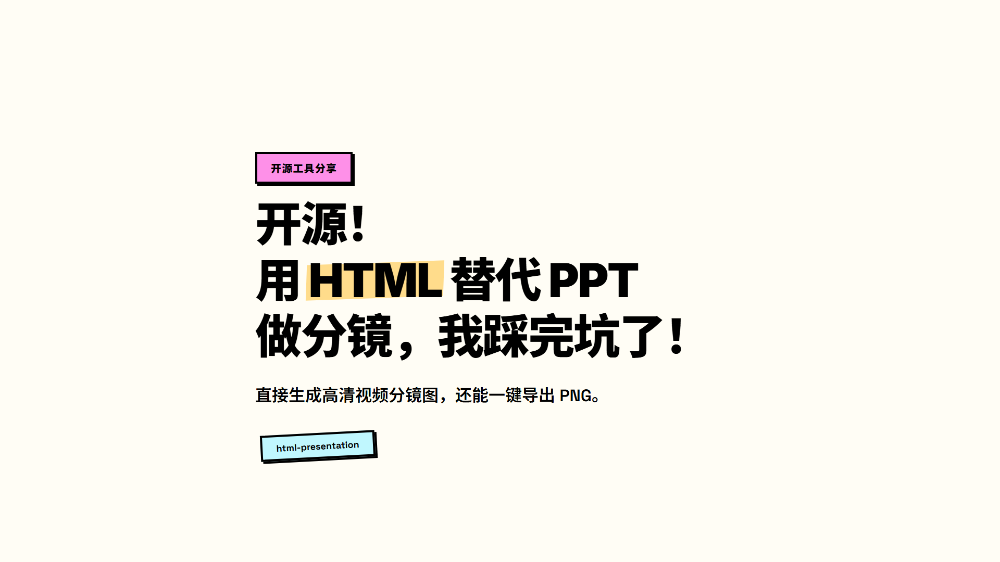
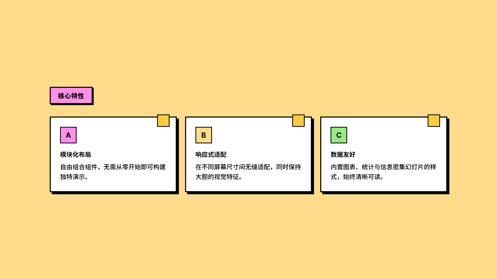
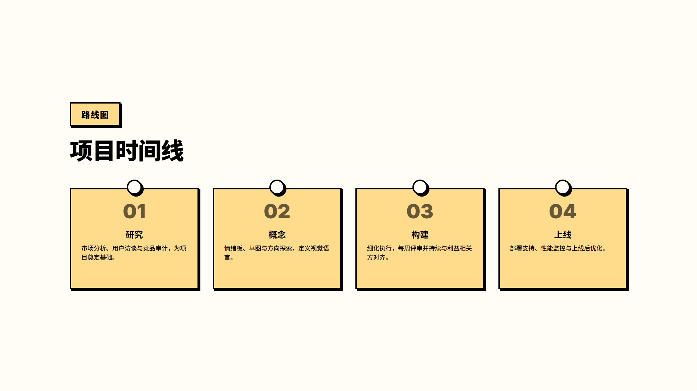
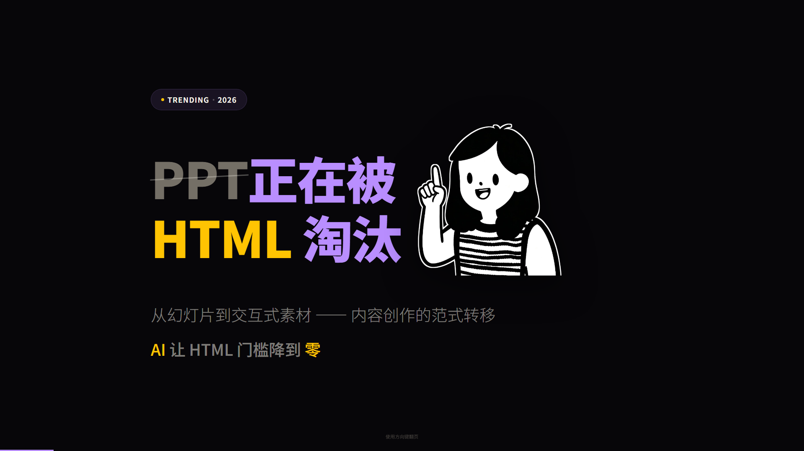
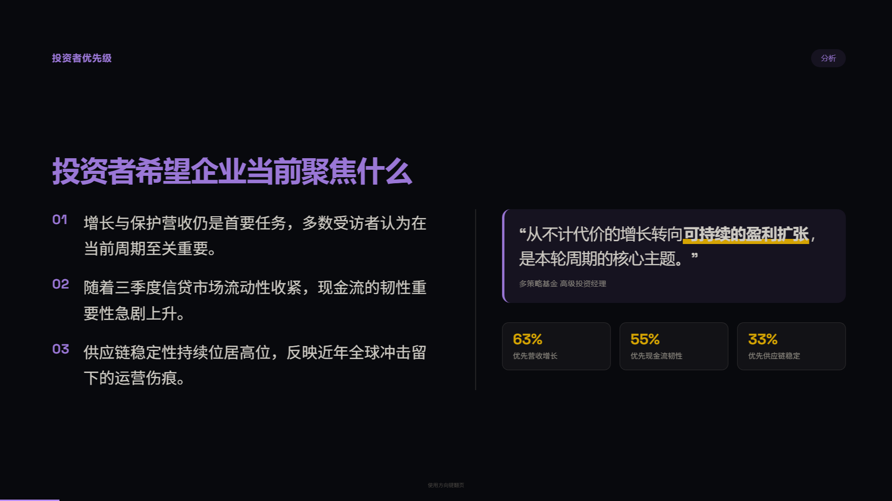
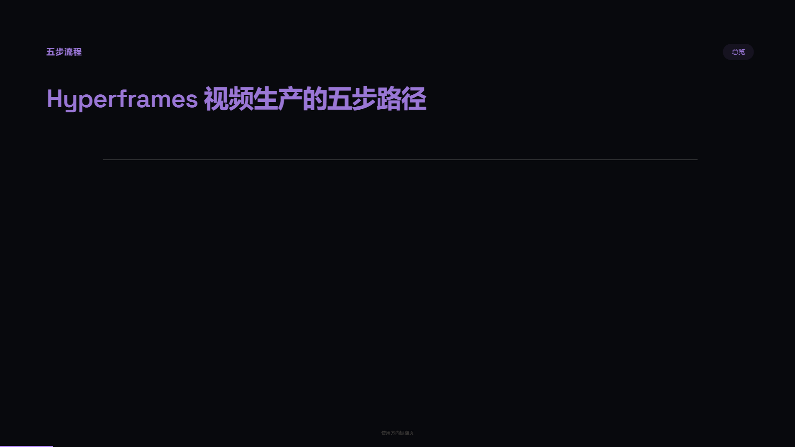

# HTML Presentation · 视频友好版

<p align="center"><strong>把逐字稿或导演稿，整理成可交给 AI 生成的 HTML 演示提示词</strong></p>

<p align="center">
  <a href="https://juanjuanjie.github.io/html-presentation/">在线使用</a> ·
  <a href="https://www.bilibili.com/video/BV1HToiBCEwg">项目教程</a> ·
  <a href="https://www.bilibili.com/video/BV1g5j46iE5C">为什么用 HTML 替代 PPT</a>
</p>

HTML Presentation 是一个静态、隐私友好的 HTML 演示与视频分镜工具。你可以在首页导入稿件、选择生成模式和视觉模板，获得一份包含稿件、模板源码与生成规则的完整提示词，再交给常用的 AI Agent 生成最终 HTML。

- **演讲 HTML**：从逐字稿提炼观点，按内容组织页面，适合课程、分享和手动演示。
- **导演 HTML**：严格按照导演稿一镜一页生成，保留逐镜口播、画面与动效要求。
- **本地读取**：稿件只在当前浏览器页面中处理，不上传、不持久保存。
- **视频友好**：模板采用 16:9 画布，可批量导出 1920×1080 PNG 分镜。

## 在线页面

项目根目录的 [`index.html`](./index.html) 是 GitHub Pages 入口，包含四个页面：

- **首页**：选择演讲 HTML 或导演 HTML，导入稿件并准备完整 Agent 提示词。
- **模板**：浏览 3 套模板与配色，展开编辑面板实时微调颜色和字体。
- **动效**：查看适合导演稿的可复用动效组件。
- **README**：直接在站内阅读本说明。

本站不接入模型密钥，也不会自动调用 AI。生成提示词后，请复制到你使用的 AI Agent，并逐页检查内容、溢出与可读性。

## 当前模板

| 模板 | 页面 | 视觉特点 | 配色 |
|---|---:|---|---|
| **Doodle Cream** | 13 | 白纸暖黄、手绘人物、不规则流程 | 白纸暖黄 |
| **BlockFrame** | 13 | 粗黑边框、糖果色块、新粗野主义 | 糖果亮色、复古纸感、暗黑糖果 |
| **Professional** | 15 | 克制留白、科技感排版、报告型信息结构 | 奶油钴蓝、紫金暗色、黑绿专业 |

模板卡片、编辑面板和生成器共享同一套模板数据。编辑配色只通过 URL 参数覆盖 CSS 变量，不会修改模板源文件。

## 效果预览

以下图片均直接从当前模板 HTML 截取，统一为 1920×1080。每套模板展示 3 个代表页面，避免封面图尺寸不一致。

### Doodle Cream

<table>
  <tr>
    <td width="33.33%"></td>
    <td width="33.33%"></td>
    <td width="33.33%"></td>
  </tr>
</table>

### BlockFrame

<table>
  <tr>
    <td width="33.33%"></td>
    <td width="33.33%"></td>
    <td width="33.33%"></td>
  </tr>
</table>

### Professional

<table>
  <tr>
    <td width="33.33%"></td>
    <td width="33.33%"></td>
    <td width="33.33%"></td>
  </tr>
</table>

## 快速开始

### 1. 在线使用

打开 [GitHub Pages](https://juanjuanjie.github.io/html-presentation/)，选择模式、模板和稿件，然后复制完整提示词到 AI Agent。

### 2. 本地预览

请通过本地 HTTP 服务打开项目，不建议直接双击 `index.html`，因为浏览器可能阻止模板文件读取。

```bash
python -m http.server 9966
```

浏览器访问 `http://127.0.0.1:9966/`。

### 3. 直接制作模板

复制任意模板作为起点：

```bash
cp themes/doodle-cream/template.html my-presentation.html
```

每个页面使用 `.slide` 元素，当前页使用 `.active` class。模板为单文件 HTML，便于复制、版本控制和交给 AI 修改。

## 导演稿最小格式

导演 HTML 会检查从“镜 01”开始的连续编号，不自动补镜、合并镜头或添加额外封面。每个镜头建议包含布局、画面、花字、图示、动效、转场与口播。

```md
## 镜 01｜开场提问

- 布局：居中大字，画面留白
- 画面：问题从模糊逐渐变清晰
- 花字：学编程还值得吗？
- 图示：抽象代码符号与一个问号
- 动效：花字淡入，问号轻微放大
- 转场：问题向左退出，衔接下一镜
- 口播：如果 AI 一秒钟就能写出你练三个月的代码，那你辛苦学的编程，还值钱吗？
```

详细规则见 [`docs/generation-modes.md`](./docs/generation-modes.md)。

## 导出 PNG 分镜

安装依赖与 Chromium：

```bash
pip install -r requirements.txt
playwright install chromium
```

导出模板全部页面：

```bash
python scripts/screenshot_html_slides.py themes/doodle-cream/template.html -o slides_out
```

输出文件为 `slides_out/page_01.png`、`page_02.png`……，默认画幅为 1920×1080。完整参数见 [`scripts/README.md`](./scripts/README.md)。

## 项目结构

```text
html-presentation/
├── index.html                       # GitHub Pages 入口与模板数据
├── README.md                        # 项目说明
├── SKILL.md                         # 视频友好设计规范
├── NOTICE.md                        # 致谢与来源声明
├── assets/
│   ├── generator.css                # 生成器与模板编辑面板样式
│   ├── generator.js                 # 双模式校验与提示词组装
│   ├── navigation.js                # 首页 / 模板 / 动效 / README 路由
│   ├── previews/                    # 模板卡片预览图
│   └── readme-previews/             # README 的 3×3 统一预览图
├── scripts/
│   ├── screenshot_html_slides.py    # 批量导出幻灯片 PNG
│   ├── generate_variant_previews.py # 更新配色变体预览
│   └── test_generator.py            # 页面与生成器冒烟测试
├── themes/
│   ├── doodle-cream/
│   ├── blockframe/
│   ├── blockframe-dark/             # BlockFrame 暗色变体
│   └── purple-gold-presentation/    # Professional 模板与配色变体
└── .github/workflows/pages.yml      # GitHub Pages 自动部署
```

## 设计原则

1. **单页单点**：每页只承担一个明确任务，标题尽量直接表达结论。
2. **字号够大**：保证录屏、视频压缩和移动端观看时仍然清楚。
3. **留白充足**：避免信息贴边，也为字幕、头像和平台控件预留空间。
4. **结构优先**：先完成故事规划和页面蓝图，再把内容放入模板。
5. **逐页自检**：发布前检查逻辑、溢出、对比度和翻页节奏。

## 部署

仓库已配置 GitHub Actions（`.github/workflows/pages.yml`）。在仓库 **Settings → Pages** 中选择 **GitHub Actions** 作为部署来源，推送到 `main` 后会自动更新 GitHub Pages。

## 作者与致谢

由 [卷卷姐 juan](https://space.bilibili.com/229150291) 制作并维护。

项目基于 [Zara Zhang](https://github.com/zarazhangrui) 的 [frontend-slides](https://github.com/zarazhangrui/frontend-slides) 与 [beautiful-html-templates](https://github.com/zarazhangrui/beautiful-html-templates) 改编。详细声明见 [`NOTICE.md`](./NOTICE.md)。

## License

[MIT](./LICENSE)
